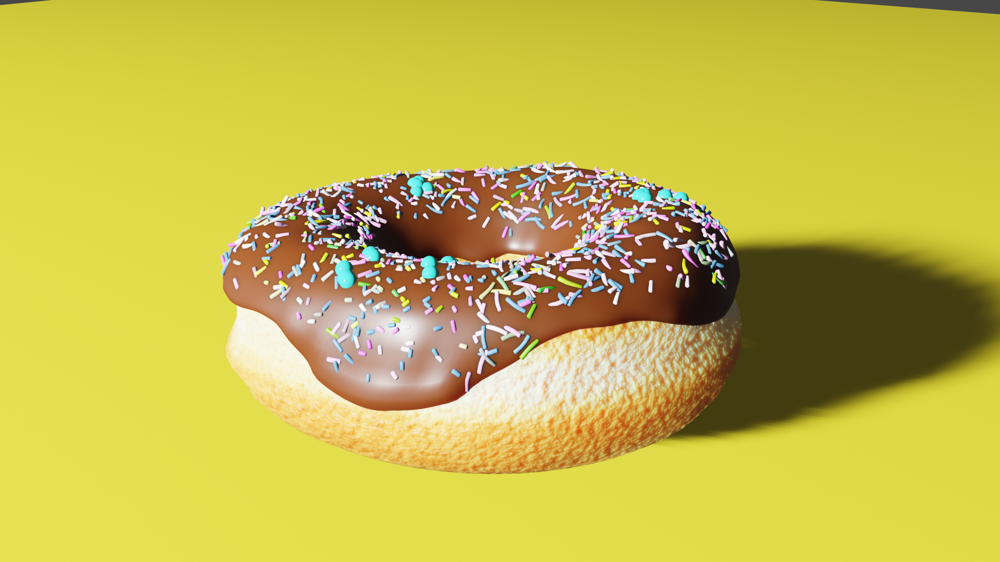

# FPS Prototype - My First Unity Game

  

*One sci-fi room, six weapons, a lot of tutorials, and a summer I still remember very well.*

**[▶ Watch the FPS showcase](https://youtu.be/znu3GvFBwvo)** · **[⬇ Download the Windows build](https://github.com/nikolasa004/FPSPrototype/releases/tag/v1.0.0)**

This is the **first game I ever made in Unity**. It's an old first-person shooter prototype from my early high-school years, around 2020-2021. It never became the game I imagined, but it ended up being one of the most important projects I've worked on - mostly because of everything that happened while I was trying to make it.

## So, what is actually here?

Not a complete FPS, that's for sure. There's one sci-fi room, a character you can move around in first person, and a collection of weapons I spent a surprising amount of time getting to work.

You can walk, look around, jump, sprint, crouch, switch between **six weapons** (pistol, knife, SMG, shotgun, rifle, and sniper rifle), shoot at simple targets, aim, and reload. I also experimented with animations, sounds, camera shake, hit effects, lighting, and a little ammo display.

  
  

The environment has glowing green machinery, an upper walkway, and a lot of dramatic lighting. Most of the weapons and environmental models come from third-party assets; at this point I was learning how to *use* a game engine, not how to create an entire 3D world from scratch.

### Some shooting, aiming, and reloading

  
  
  

  
  

  
  

**[The video shows the room and weapon mechanics much better than still pictures do →](https://youtu.be/znu3GvFBwvo)**

## How I got into this in the first place

When I started high school, I was in a computer science-focused class, but I really didn't know much about programming yet. I wanted to get better at it, and making a game seemed like a pretty exciting way to practice. I'd already struggled through a tiny Windows Forms game tutorial, which felt incredibly impressive to me at the time even though I barely understood what I was doing.

Then I started watching **Dani** on YouTube. His videos about making games in Unity were so chaotic and funny that I remember thinking something along the lines of: *Well, if he can do it, surely I can at least try.* He often mentioned **Brackeys**, so naturally I went there too.

And because I had absolutely no idea how difficult any of this was, I decided my first Unity game should be a **first-person shooter**. I knew games like *Doom*, I liked the idea of making my own sci-fi shooter, and that was apparently enough of a plan for me.

## The part where I nearly gave up

The first thing I needed was pretty basic: a character that could move and a camera that could look around.

I followed a tutorial and spent something like two or three days trying to make those two things work. They didn't. I gave up on the project entirely.

About half a year later I tried again, convinced that I simply hadn't tried hard enough the first time. I went through the tutorial faster this time, spent a whole day on it, and... it still didn't work.

I can still remember lying in bed that night, genuinely upset with myself. I wanted to make an entire FPS, yet I couldn't even get movement and mouse look working. At that point my programming knowledge barely went beyond things like `if`, `for`, and `Console.WriteLine`. I didn't really understand classes, methods, or most of the Unity code I was looking at. In hindsight, it's hardly surprising that I struggled.

I don't remember exactly what changed my mind that night. Maybe it was something I'd watched or heard. But I remember deciding that **I wasn't going to quit just because this was difficult**. Other people had figured it out, so I could keep trying too.

The next day, instead of fighting the same tutorial again, I found a different one.

**Movement and camera controls worked on the first try.**

It's funny how small that sounds now. But I really do think that moment changed the way I approached programming. If I'd stopped there, I'm not sure I would have gone on to make all the other game projects that followed.

## One summer, a lot of tutorials

After that, I kept adding things. A tutorial for movement. Another one for shooting. Others for building an environment, weapons, animations, sounds, and whatever else I thought looked interesting. I took bits of what I was learning, tried to make them fit together, broke things, and tried again.

I spent a huge part of that summer working on this - often around eight hours a day. Looking at the actual result now, it's almost ridiculous how much time I spent on something so small. With what I know today, a lot of it could probably be recreated very quickly.

But the result wasn't really the point. I was learning Unity, C#, animation, working with 3D assets, and, most importantly, **how to keep looking for a solution when the code refused to cooperate**.

I didn't have an AI assistant to explain every error. I was searching the internet, reading Stack Overflow, watching tutorials in English, and sometimes discovering that the tutorial was outdated or just didn't work in my version of Unity. That could be frustrating, but it also made me much more comfortable with debugging and figuring things out on my own.

I've started more than twenty game projects since then, finished or unfinished. This little FPS is where that habit of experimenting - and not immediately giving up - really began.

## The game I actually wanted to make

The single room you see in the screenshots was supposed to be just the beginning.

My idea was a science-fiction FPS that started inside something like an alien laboratory or space facility. You would explore the interior, meet your first enemies, and eventually leave the building.

And *that* was the part I was most excited about: outside, the game would open up into a natural wilderness full of hostile, high-tech, alien-looking robots. I loved the contrast between advanced machinery and ordinary nature. The robots weren't meant to be robotic animals; I imagined something more obviously artificial and extraterrestrial.

I later learned about *Horizon Zero Dawn*, which has a somewhat similar contrast between machines and wild landscapes, although the game and the machines I had in mind were quite different.

Of course, none of that outdoor world, enemy AI, or larger game ever got built. I only managed the room and some basic FPS mechanics. That's why I'm calling this a **prototype**, not an unfinished release of some nearly completed game.

## Why I stopped - and started learning 3D modeling

School started again, and I had less time. I always took my grades seriously, so game development went on hold for a while.

There was another thing bothering me, though: **almost all the models in my FPS were made by someone else**. I knew I was doing my own learning and programming, but I wanted the actual world to feel like *mine* too. I didn't like the thought of making a game that looked like a collection of the same assets anyone else could download.

So I decided I would learn to make my own 3D models.

I started with Blender tutorials and small practice objects - donuts, coffee, utensils, that sort of thing. I tried not to rush ahead immediately; I wanted to understand the tools first. Once I felt ready, I made a sword of my own design and decided to attempt a much more ambitious robot.

### The robot that never made it into the game

  
  

  
  

  

I think I modeled most of this in about a day, and I was pretty happy with the amount of detail. But then came texturing, materials, and all the other work needed to actually finish a model. I found that part much less enjoyable. I was also trying to make something far too complicated for my experience level, using only a mouse and keyboard.

So the robot stayed like this: **a model I made, but never finished, textured, animated, or added to the FPS**. I still wanted to include these images here because that attempt was an important part of the same learning journey.

### Some of my other early models

  

  
  

The **donut and coffee** came from following modeling tutorials. The **sword**, on the other hand, was my own design. They're not assets from the FPS - just some of the things I made while trying to learn enough 3D modeling to create a game without relying so much on other people's models.

Eventually I realized that making a fully 3D game with all my own assets would take far more time than I could give it. When I returned to Unity, I started exploring **2D games and pixel art** instead. But that's a story for another repository.

## Downloading the prototype

You can get the playable Windows version from **[Releases](https://github.com/nikolasa004/FPSPrototype/releases/tag/v1.0.0)**.

1. Download `FPSPrototype.zip`.
2. Extract the **entire** archive, not just the `.exe` file.
3. Run the executable inside the extracted folder.

There isn't a campaign, a win condition, or a completed enemy system. This is mainly a little room where you can walk around and test the FPS mechanics.

### About the source code and assets

The repository contains parts of my original Unity project, including my scripts, animations, and scene files. **It is not a completely self-contained, ready-to-rebuild Unity project**: third-party weapons, environment assets, tools, and other resources have been excluded from the public source because they aren't mine to redistribute as standalone files. Some references will therefore be missing if you open the project directly in Unity.

The code is also very much beginner code. I wrote and adapted it while following different tutorials and learning concepts I barely understood at the time. Years later, I made a few small fixes so the old prototype could run again, but I didn't try to rewrite it into something it was never meant to be.

I wanted to share it because **this tiny, unfinished FPS was where I learned that struggling with a problem didn't mean I had to stop**. And I'm still glad I went back for that second attempt.
